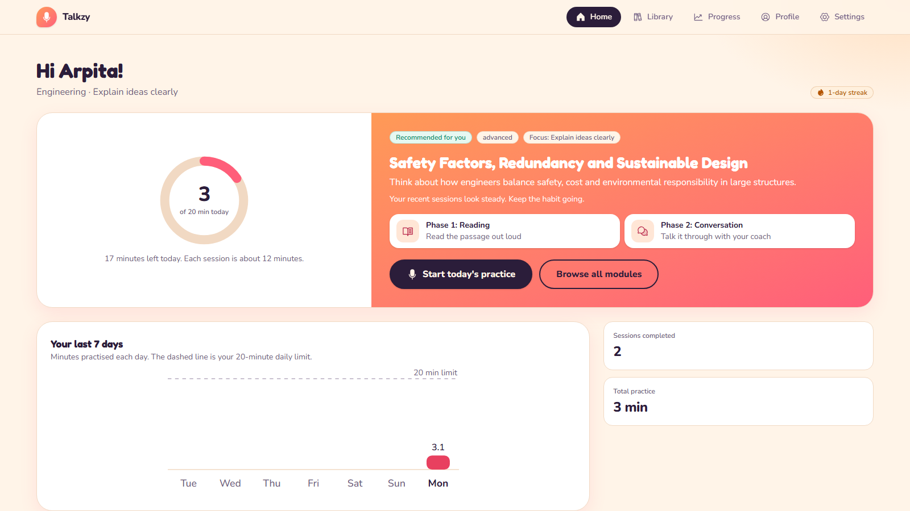
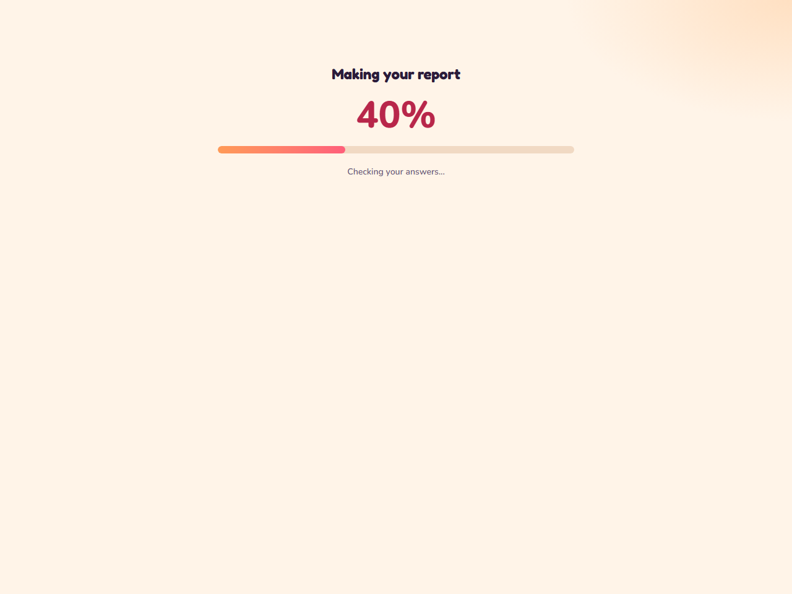
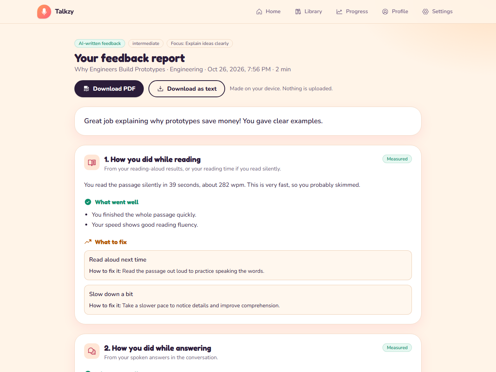
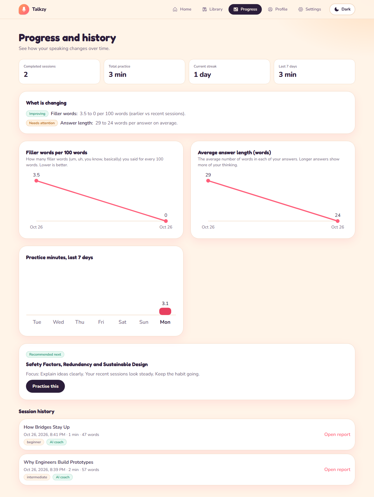
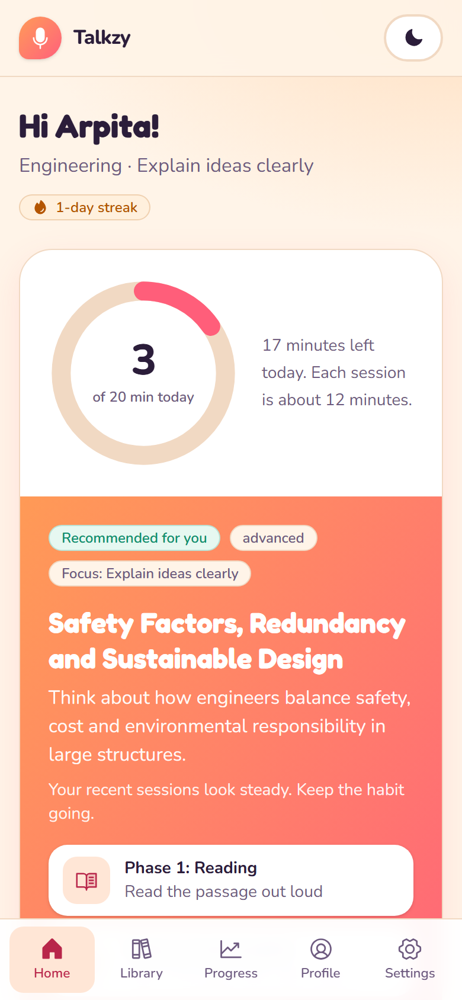

# Talkzy

**Talkzy helps school and college students speak English with more confidence.** Pick a subject, read a short passage out loud, talk it through with a friendly AI coach, and get a feedback report in very simple language that shows what went well, what to fix and exactly how to fix it.

Live site: <https://talkzy-communication-coach-fk4c.vercel.app>

English only. No accounts. Practice is capped at **20 minutes a day**, and everything is saved on the student's own device.

<p align="center">
  
</p>

## How it works

Each session has two phases and ends with a report.

| | Step | What happens |
|---|---|---|
| 1 | **Reading** | A passage for the student's field appears. They read it out loud. Reading accuracy and pace are measured, and the words they said are matched against the text. |
| 2 | **Conversation** | The coach asks a question out loud, the student answers with their voice (or types), and the coach follows up using the passage and the student's own answers. |
| 3 | **Report** | A personal report is written from what the student actually said and did. |

<table>
  <tr>
    <td width="50%"><br><sub><b>Phase 1.</b> Read the passage out loud.</sub></td>
    <td width="50%"><br><sub><b>Phase 2.</b> Talk it through with the coach. Typing and End session are always available.</sub></td>
  </tr>
</table>

## The feedback report

While the report is made, a **percentage and progress bar** show how far along it is. With the AI on, it usually takes about **3 seconds**.

The report is short and written in simple English. It shows **what went well** (up to 2 points), **what to fix** (up to 2 points, each with the student's own words and what to try), **one "say it like this" example** and **one thing to practise today**. Tap **See the full report** for the rest.

Points about the reading and the numbers (fillers, pace, how much was read) come from the measurements, so they are always true. The AI's own points are checked too: empty praise such as "you answered every question" is never shown.

- **"Instead of this, say it like this"** takes sentences the student really said and shows a clearer way to say them. Every quote is checked against the transcript on the server, so the coach can never show something the student did not say.
- Every number is labelled **Measured**, **Calculated** or **AI assessment**.
- **Download PDF** or **Download as text**. The file is made on the device and nothing is uploaded.
- If the AI step fails, the report still shows the measured results and a **Try again** button asks for the written feedback again.

<table>
  <tr>
    <td width="30%"><br><sub>A percentage while the report is made.</sub></td>
    <td width="70%"><br><sub>The short report.</sub></td>
  </tr>
</table>

## Your subject, your goal, your modules

The student chooses a **subject or specialization**, a **difficulty** and **what they want to improve** once, when they start. There is a different module for every subject, difficulty and goal (**8 x 3 x 5 = 120 modules**), each with its own passage, its own kind of activity and its own questions. The **Library shows only the three that match the student's subject and goal**, with their own level first, so nothing has to be chosen again. To change any of it, open **Profile** and tap a section. Everything then updates by itself.

The coach asks questions **from easy to difficult**: questions 1 to 3 are warm-ups, 4 and 5 need a reason or an example, and from 6 on they ask for an opinion and a defence of it. The screen shows which kind of question it is.

While the student speaks, their words appear **live** on screen (from the browser's own speech recogniser). The accurate text from Sarvam replaces them a moment after the student stops, and that is the text that is saved and measured.

<table>
  <tr>
    <td width="50%"><br><sub>Profile: tap a section to change it.</sub></td>
    <td width="50%"><br><sub>Library: only the student's subject.</sub></td>
  </tr>
</table>

Speech recognition and the coach's voice use **English (India)** only, so there is no accent setting to change.

## Progress and daily practice

Trends appear by themselves once there are two sessions to compare: filler words per 100 words, average answer length, practice minutes, a streak, and a recommendation for what to practise next.

<table>
  <tr>
    <td width="68%"></td>
    <td width="32%"><br><sub>Works on phones.</sub></td>
  </tr>
</table>

More screens: [onboarding](docs/screenshots/01-onboarding.png), [library](docs/screenshots/03-library.png) and [start of a session](docs/screenshots/04-start-session.png).

## What it measures, and what it never claims

- **Measured:** speaking pace, pauses and thinking time, filler words, repeated words, answer length, word variety, reading accuracy.
- **AI assessment (live mode):** grammar, vocabulary, structure and relevance, always labelled as the AI's opinion.
- **Camera (optional, on the device only):** whether the face is in view, head direction, posture, hand and body movement. The video never leaves the device.
- Pronunciation is **not scored**. Filler counts are a lower bound because browser recognisers often drop "um" and "uh".
- The app **never infers emotion, confidence, personality or honesty** from the camera, and says so in the report.

## Tech

- **Next.js 16** (App Router, Turbopack), **React 19**, **TypeScript**, **Tailwind CSS 4**, Zod for validation.
- **Voice in:** [Silero VAD](https://github.com/snakers4/silero-vad) in the browser finds each stretch of speech, and each segment is sent through the app's own server route to **Sarvam** speech-to-text. The browser's own recogniser is an automatic fallback.
- **Voice out:** **Cartesia Sonic** through a server route. The browser voice is the fallback.
- **AI:** **Groq** writes the coach's replies (`openai/gpt-oss-20b`, fast) and the report (`openai/gpt-oss-120b`, more accurate). Anthropic is an optional alternative.
- **Camera:** MediaPipe Face and Pose Landmarker, running on the device through WebAssembly. The models start loading as soon as the camera box is ticked, so they are ready when the session begins.
- **Report files:** jsPDF, in the browser.
- **Tests:** Vitest (785 unit tests, including checks of all 120 modules) and Playwright (25 end-to-end tests).
- **AI quality check:** `npm run eval` runs made-up sessions with planted mistakes through the real AI and marks the result. See [How well does the AI feedback work?](docs/EVALUATION.md).

API keys are read only by server code and never sent to the browser. A Content-Security-Policy (`connect-src 'self'`) stops the page contacting any outside server.

## Run it locally

You need **Node.js 20 or newer** and a recent **Chrome or Edge**.

```bash
npm install
npm run dev
```

Open <http://localhost:3000>.

`npm install` also runs `npm run setup:vision`, which copies the MediaPipe runtime and downloads two small pretrained models (about 9 MB) and the Silero voice-detection files (about 17 MB). If the download fails the app still works, only without body-language analysis; run `npm run setup:vision` again to retry.

### Add your keys

Everything is optional. Without keys the app runs in a clearly labelled **development mode** (scripted coach, no AI report, browser voice).

```bash
cp .env.example .env.local      # Windows PowerShell: Copy-Item .env.example .env.local
```

| Variable | Used for | Without it |
|---|---|---|
| `GROQ_API_KEY` | The coach's replies and the AI-written report | Development mode |
| `GROQ_CHAT_MODEL`, `GROQ_REPORT_MODEL` | Optional. Which Groq models talk and write the report (defaults: `openai/gpt-oss-20b` and `openai/gpt-oss-120b`) | The defaults |
| `SARVAM_API_KEY` | Speech-to-text for the student's voice | The browser's own recogniser |
| `CARTESIA_API_KEY` and `CARTESIA_VOICE_ID` | The coach's spoken voice | The browser's own voice |
| `ANTHROPIC_API_KEY` | Optional alternative to Groq | n/a |

Restart `npm run dev`, then open <http://localhost:3000/api/status>. With everything set it shows `{"mode":"live","llm":"groq","stt":"sarvam","tts":"cartesia"}`. Anything shown as `dev` or `browser` means that key is missing or misspelt. `.env.local` is git-ignored.

### Scripts

| Command | What it does |
|---|---|
| `npm run dev` | Development server on port 3000 |
| `npm run build` and `npm start` | Production build and server |
| `npm run lint` and `npm run typecheck` | ESLint and TypeScript |
| `npm test` | Unit tests |
| `npm run test:e2e` | End-to-end tests against a production build, using mock voice and AI services. The first run needs `npx playwright install chromium`. |
| `npm run setup:vision` | Re-copy the camera and voice-detection files |

## Deploy to Vercel

1. Push the repository to GitHub and import it at [vercel.com/new](https://vercel.com/new). The framework is set to Next.js by `vercel.json`.
2. Add `GROQ_API_KEY`, `SARVAM_API_KEY`, `CARTESIA_API_KEY` and `CARTESIA_VOICE_ID` under **Settings → Environment Variables** (Production and Preview), then deploy.
3. If students see a Vercel login page, turn off **Vercel Authentication** under **Settings → Deployment Protection**.

The rate limiter is in memory and per server instance. Use a shared limiter if you expect heavy traffic.

## Privacy and minors

No accounts and no passwords: a display name only. Under-13s need a guardian's confirmation. The camera is opt-in each session. Raw audio and video are never stored. Students can turn off transcript saving, and can delete a session or all their data from Settings. Short speech clips go through the app's server to Sarvam to be turned into text and are then discarded. The app explains this before first use. Schools that deploy it should add their own consent process. See [docs/SECURITY.md](docs/SECURITY.md).

## Project layout

```
docs/                     Product, architecture, design, security, decisions and test plan
src/app/                  Pages (home, library, practice, report, progress, profile, settings, privacy) and API routes
src/components/           UI, including the reading and conversation screens
src/features/content/     8 subjects x 3 levels x 5 goals = 120 modules (passage, key terms, questions easy to hard)
src/features/speech/      Speech metrics, reading alignment, voice timing, recognition and synthesis
src/features/vision/      On-device face and pose analysis
src/features/coach/       Prompts, dev-mode coach, quote checking, rule-based coaching
src/features/report/      The short report, and PDF and text export
evals/                    The AI quality check (made-up sessions, marking, results)
src/features/progress/    Daily limit, streaks, trends, recommendations
src/services/             Local storage, API client, hooks
tests/unit, tests/e2e     Vitest and Playwright
```

## Known limits

- Pronunciation is not scored, and the camera numbers describe geometry only. Camera accuracy on real people has not been validated.
- Chrome's own speech recogniser is covered by fakes in the tests, not by a real microphone.
- 24 passages means regular students will see content again, although the AI coach varies its questions.
- Data lives in each browser, with no sync between devices.
