# Talkzy

**Talkzy helps school and college students speak English with more confidence.** The student picks a subject, reads a short passage out loud, then has a real, spoken conversation with an AI coach about what they read. At the end they get a short feedback report in very simple language: what went well, what to fix, and exactly how to fix it.

Live site: <https://talkzy-six.vercel.app> (Settings shows the app version, so it is easy to see which upload is live).

English only. No accounts. Practice is capped at **20 minutes a day**, one session is about **12 minutes**, and everything is saved on the student's own device.

<p align="center">
  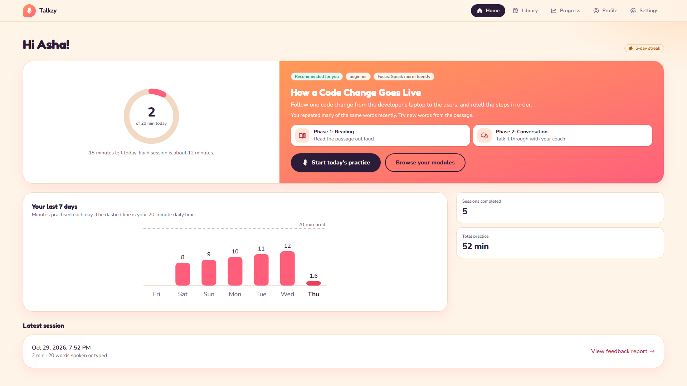
</p>

## How a session works

| Phase | What happens |
|---|---|
| **1. Reading** | A passage for the student's subject appears. They read it out loud and each word is underlined as it is heard. Reading accuracy and pace are measured. |
| **2. Conversation** | The coach talks with the student about the passage, out loud, like a person would. There is no list of questions: every question grows out of what the student just said. |
| **3. Report** | A report is built from both phases, the reading and the conversation, while a percentage bar shows how far along it is. |

<table>
  <tr>
    <td width="33%">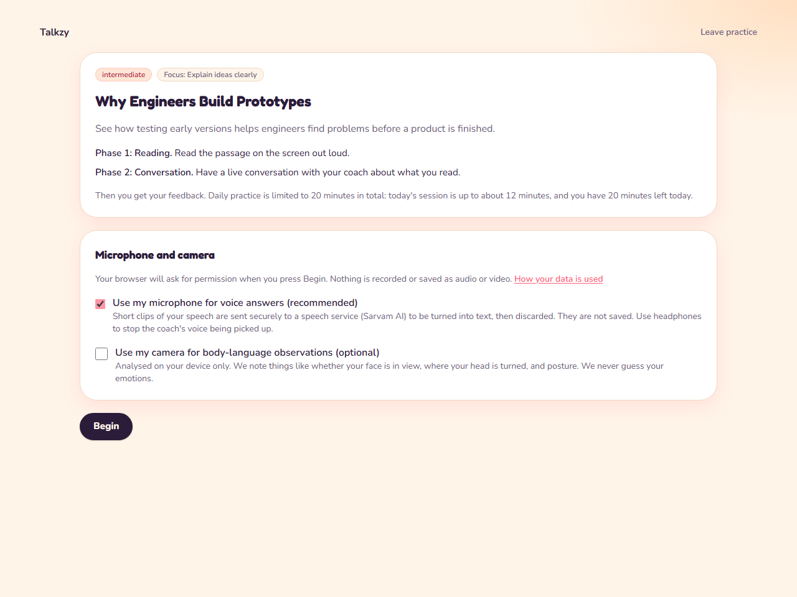<br><sub><b>Start.</b> What will happen, and the microphone and camera choices.</sub></td>
    <td width="33%">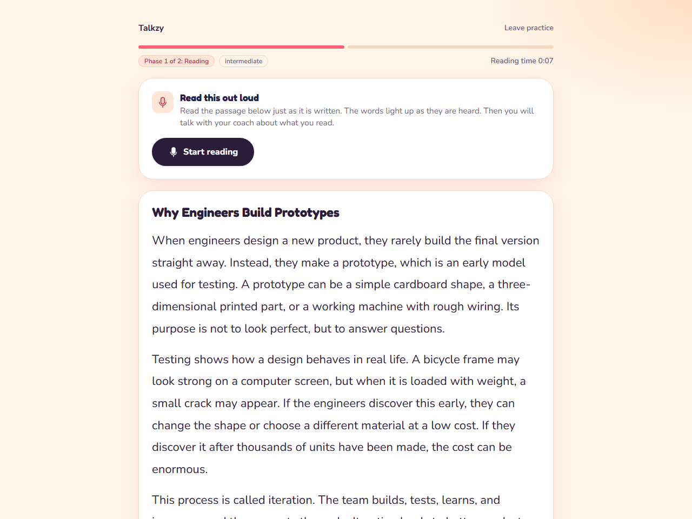<br><sub><b>Phase 1.</b> Read out loud. Green: read. Red: skipped. Orange: not said clearly.</sub></td>
    <td width="33%">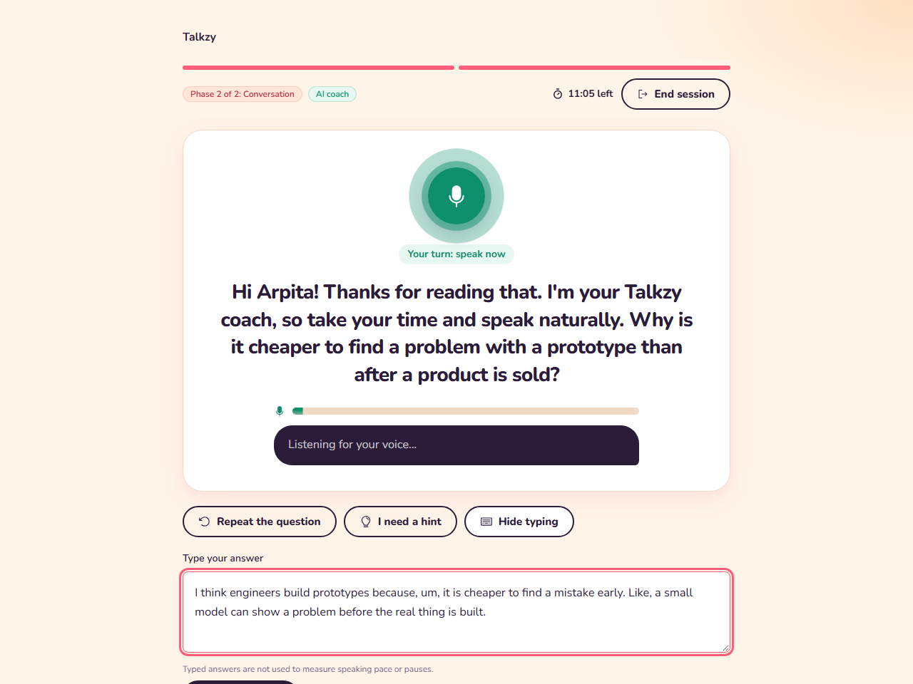<br><sub><b>Phase 2.</b> The student's words appear as they speak.</sub></td>
  </tr>
</table>

## Phase 1: the reading

- **The buttons are at the top** and stay there while scrolling: **Start reading**, then **Finish reading** (it also finishes by itself when the last word is heard), then **Start conversation** (and **Read again**). Without a microphone, **Start conversation** is there from the start.
- **Words are underlined as they are said:** green for read, red for skipped, orange for not said clearly. A matcher that does not jump ahead keeps the underline steady.
- **Live words are fast.** Chrome and Edge show their own live words at once. In any other browser, the audio heard so far is sent for transcription about twice a second: Groq's Whisper answers first (about a third of a second), and Sarvam is the backup (limited to 40 requests a minute per server, because Sarvam's pay-as-you-go plan allows 60 a minute for the whole account). Set `GROQ_STT_PARTIALS=off` to use only Sarvam.
- The **saved transcript** always comes from the accurate speech service (Sarvam), never from the live words. English letters are asked for, and if Hindi letters ever come back it is asked again.
- The coach's opening is written by the AI **while the student reads**, so the conversation starts the moment the reading ends.

## Phase 2: the conversation

The coach is a **speaking partner, not a quiz**. The module gives only the topic (the passage the student just read) and the practice goal.

- **No fixed questions.** Every turn the coach reacts to what the student really said, adds a thought of its own when it helps, and asks **one** follow-up that grows from the student's own words: why, an example from their life, what if, compare, agree or disagree. It goes easier when the student is stuck and deeper when they are fluent, remembers what was said earlier, and plays the role when the lesson is a real situation (an interview, joining a club).
- **The student can ask anything.** The coach answers first (general knowledge, English words, advice, opinions, small talk), then asks a follow-up that keeps the talk going. If the student wants to talk about something else, the coach follows their lead for a few turns and then links it back.
- **Feelings come first.** If the student says they are nervous, sad or tired, the coach answers that before anything else and makes her question about it. She never guesses a feeling from a short answer such as "No".
- **True and kind.** She says only what she is sure is true, says plainly when something is a myth, says "I am not sure" when she is not, does not grade the answers like an exam, and does not pretend to have a past of her own.
- **Natural turn-taking.** The coach never asks "Are you done?". When the student stops for a moment she simply answers: after about 1.4 s of quiet following a finished sentence, 2.2 s after a very short answer, and 3.6 s when the words stop in the middle of a sentence ("and the...", "because"). Her reply is asked for just before the pause is over, so it is ready the moment it is needed. If the student carries on while she speaks, she stops and listens. "Wait" or "let me think" makes her stay quiet for longer.
- **Buttons at the top:** **Next question** (or saying "next question" or "that's all") hands over the turn at once, **Repeat the question**, **I need a hint**, **Type instead**, and **End session**.
- **Nothing is scripted.** The opening, every reply and the goodbye are written by the AI. The student's first name is written as `{name}` by the AI and put in on the device, so **the name is never sent to the AI**. The coach never says "I am listening" or "Take your time", and she starts each turn differently from the last ones. The only fixed sentences are the emergency ones used when there is no AI (development mode) or the AI is down.
- **The talk ends by itself.** The time left sets the pace: easy at first, deeper in the middle, one last question near the end, then a warm closing. The student can also say "end the session" (or press **End session**) at any time.

<table>
  <tr>
    <td width="50%">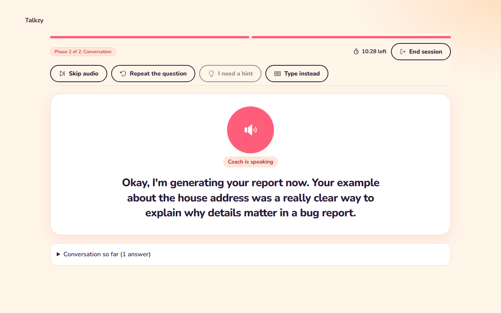<br><sub><b>The goodbye.</b> "Okay, I'm generating your report now", plus one warm line about the talk.</sub></td>
    <td width="50%">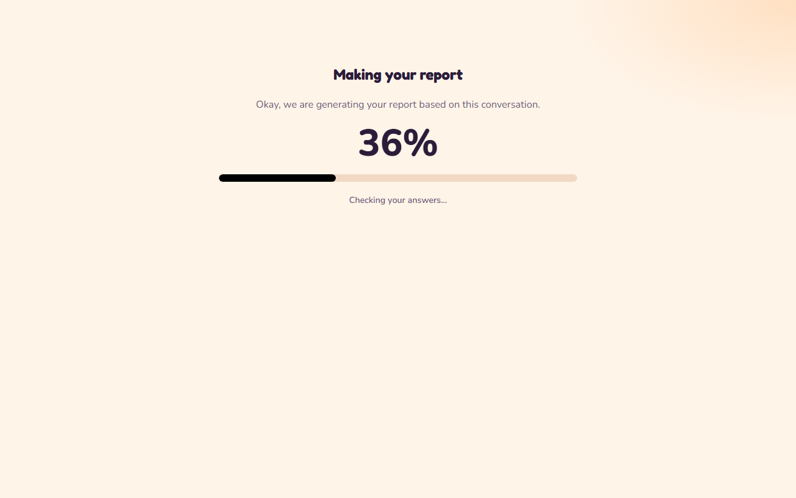<br><sub><b>The percentage.</b> Then the report opens by itself.</sub></td>
  </tr>
</table>

### The coach's voice

One voice only: the Cartesia voice ID you set in `CARTESIA_VOICE_ID`. Every reply, the goodbye and the **Hear it** button in the report use it. If Cartesia fails (no credit, a wrong key, too slow), the coach stays silent, her words are shown as text with the reason, and the app does not ask Cartesia again for a few minutes. **No second voice** (the browser voice or Sarvam's voice) takes over. The browser voice is used only when no Cartesia key is set at all; to allow Sarvam's voice as a backup, set `TTS_BACKUP=sarvam`. One coach reply costs roughly 40 to 60 Cartesia credits, so the plan needs enough credits for the number of students.

## The feedback report

The report opens with a header (name, module, a one-line summary and a tile for each part), then boxes: **Your plan for next time**, **Reading**, **Conversation**, **Your words** and **Face and body**. Each box says what went well, what to fix and **how to fix it**, in simple English. A **Download PDF** button gives the same report as a **one-page PDF** (white page, blue headings, soft blue boxes, no footer), made on the device. A sample is in [docs/sample-report.pdf](docs/sample-report.pdf).

<table>
  <tr>
    <td width="50%">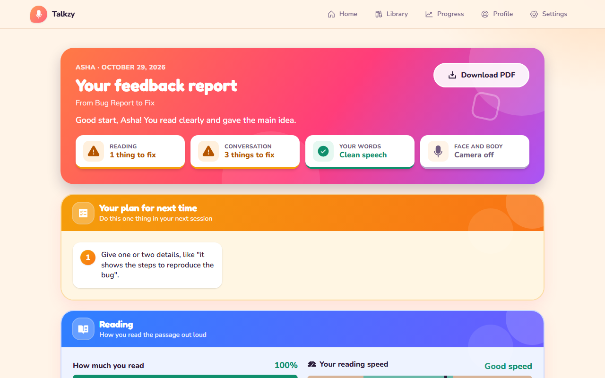<br><sub>The top of the report.</sub></td>
    <td width="50%">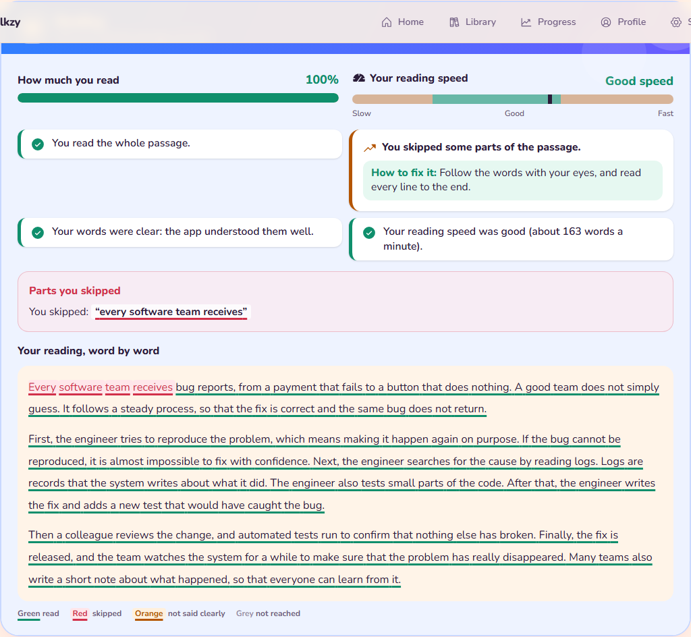<br><sub>Reading: how much was read, speed, skipped parts, words to say more clearly.</sub></td>
  </tr>
  <tr>
    <td colspan="2">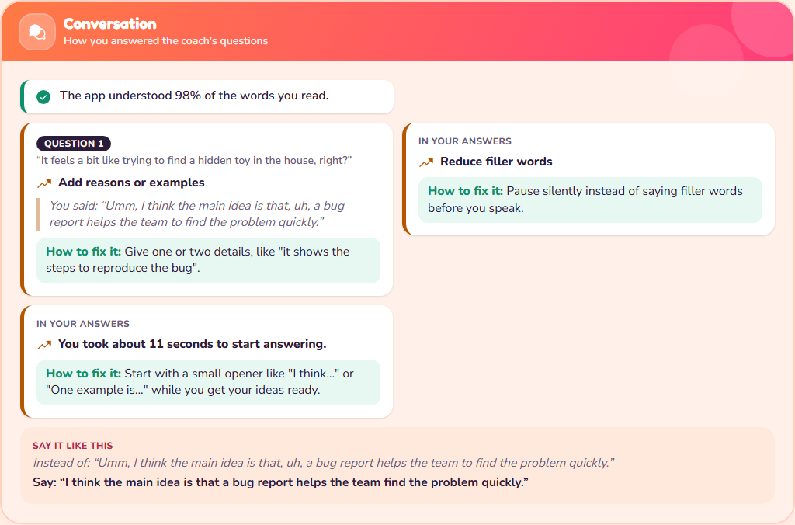<br><sub>Conversation: each thing to fix names the question it was about, shows the student's own words, and says how to fix it.</sub></td>
  </tr>
</table>

- **Reading:** which parts were skipped, where the student stopped, each word that was not said clearly (with the word in parts, such as "pass-word"), and a **Hear it** button.
- **Conversation:** what was wrong, in which question, the student's own words, and one **"Instead of this, say it like this"** example. Every quote is checked against the transcript on the server, so the report can never show something the student did not say.
- **Your words:** filler words and wrong words or forms, such as "I am agree" with the right way to say it.
- **Face and body** (only if the camera was on): how the student *looked* (tense, worried, smiling, where the head and eyes were, posture, movement). It never claims to know what they felt.
- **Points about the numbers** (fillers, pace, how much was read) come from the measurements, so they are always true. Empty praise such as "you answered every question" is never shown.
- If the AI step fails, the report still shows the reading, the measured points and the camera.

### When the browser is full

If this device has no room to keep the report, the report waits on a screen that lists the old sessions with **Delete** buttons. After a delete, the report is saved and opens at once. Nothing is ever deleted without the student pressing a button, and the report can also be opened without saving it.

<p align="center">
  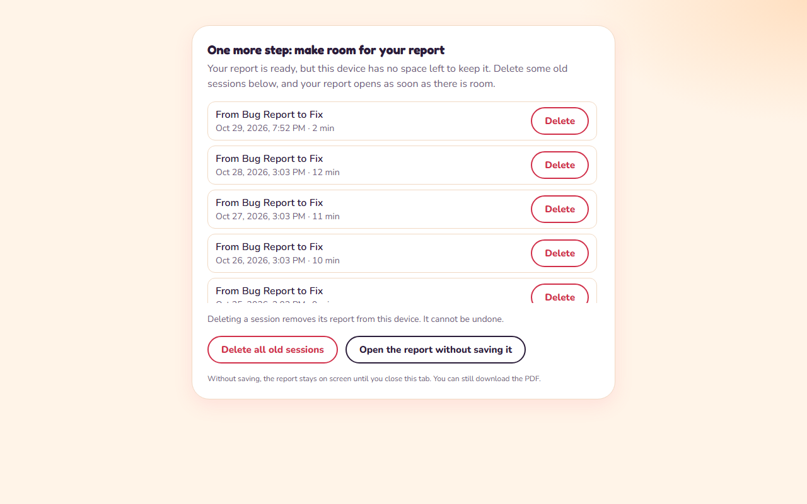
</p>

## Your subject, your goal, your modules

The student chooses a **subject**, a **difficulty** and **what they want to improve** once, when they start. There is a different module for every subject, difficulty, goal and age group (**8 x 3 x 5 x 3 = 360 modules**), each with its own passage. The age groups are **under 13**, **13 to 17** and **18 and older**: the level is about the English, and the age group changes the story, the examples and the tone. The **Library shows only the three modules that match** the student's subject, goal and age group. To change any of it, open **Profile** and tap a section. How the modules are written, and the rules the tests check, are in [docs/CONTENT-GUIDE.md](docs/CONTENT-GUIDE.md).

<table>
  <tr>
    <td width="33%">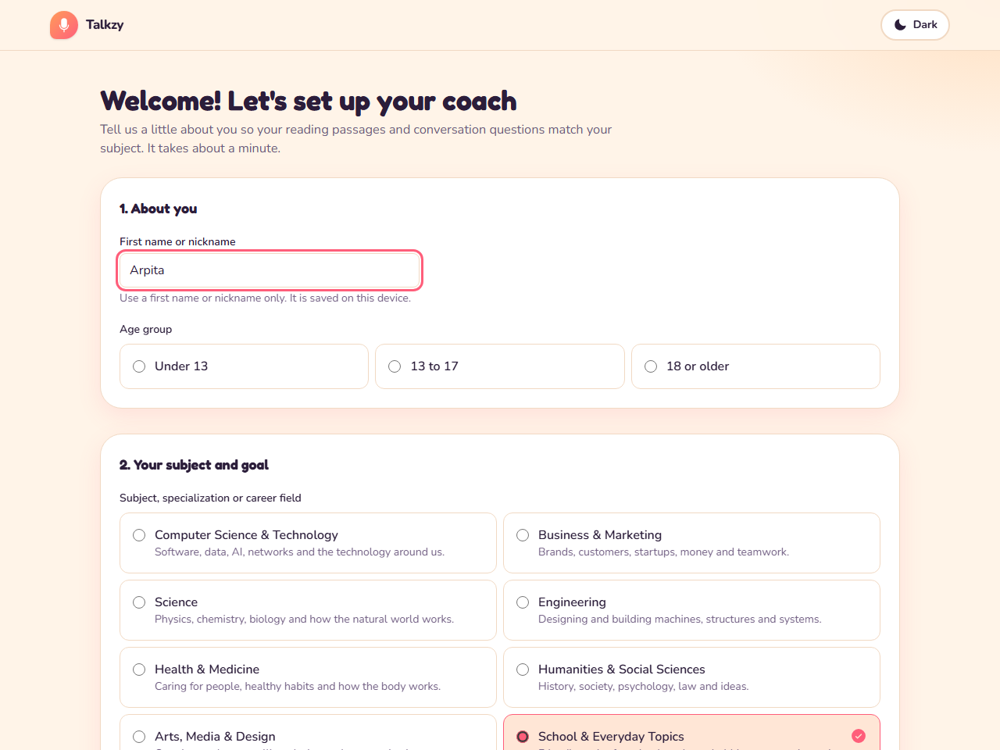<br><sub>The first-time form.</sub></td>
    <td width="33%">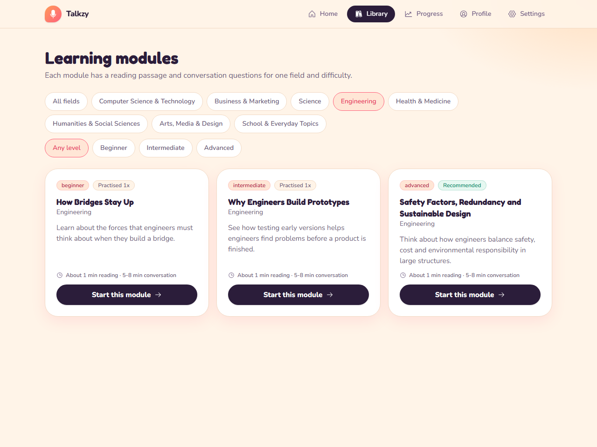<br><sub>Library: only the student's subject.</sub></td>
    <td width="33%">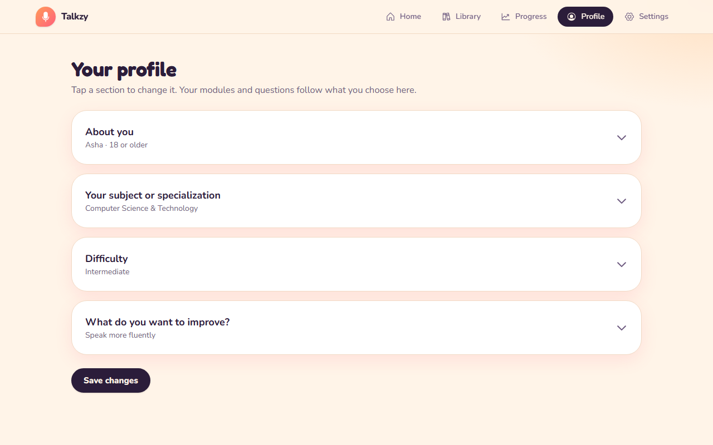<br><sub>Profile: tap a section to change it.</sub></td>
  </tr>
</table>

Speech recognition and the coach's voice use **English (India)** only, so there is no accent setting.

## Progress and daily practice

Trends appear by themselves once there are two sessions to compare: filler words per 100 words, answer length, reading accuracy, practice minutes, a streak, and a recommendation for what to practise next.

<table>
  <tr>
    <td width="30%">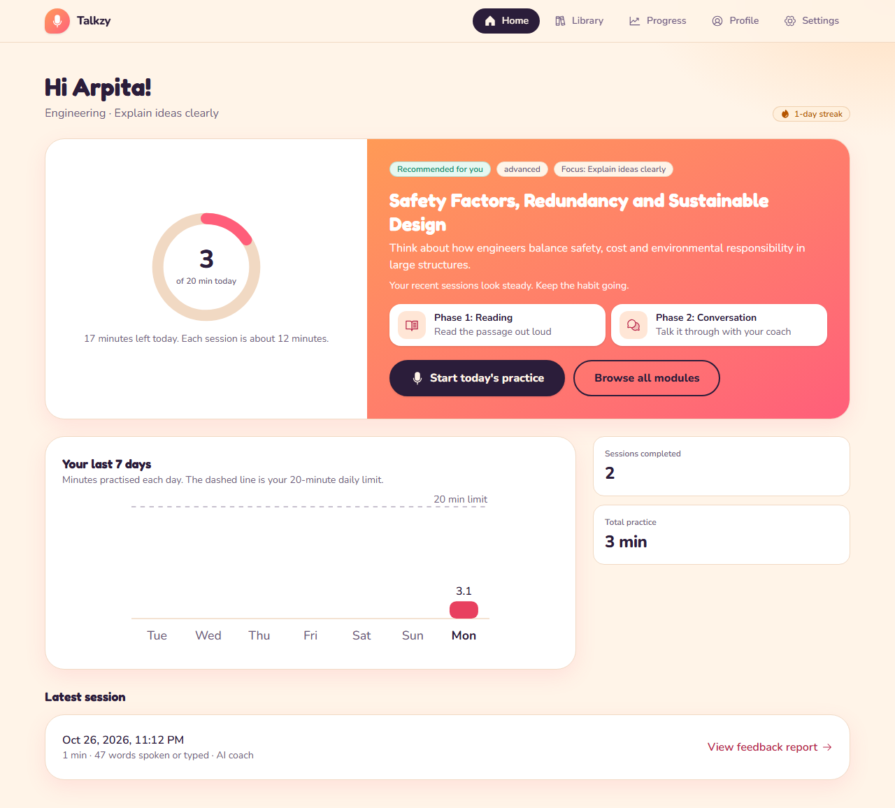<br><sub>Home.</sub></td>
    <td width="45%">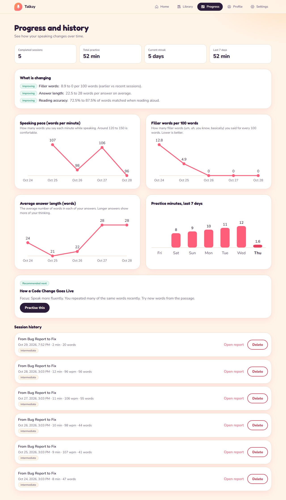<br><sub>Progress and history.</sub></td>
    <td width="25%">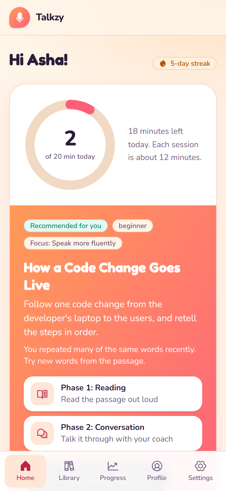<br><sub>Works on phones.</sub></td>
  </tr>
</table>

## Settings and the check page

**Settings** has the coach's voice, speaking speed, interrupting, the camera default, transcript saving, data export and delete, and shows the **app version**. If something does not work, **Check my microphone and voice** opens `/check`, which tests, in the student's own browser, the coach service, the AI, saving, the microphone, the voice detector, live words and the coach's voice, and says which one fails.

<table>
  <tr>
    <td width="50%">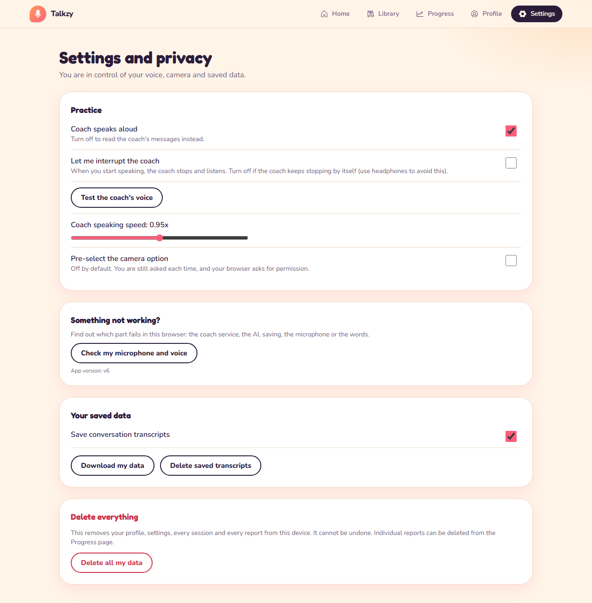<br><sub>Settings.</sub></td>
    <td width="50%">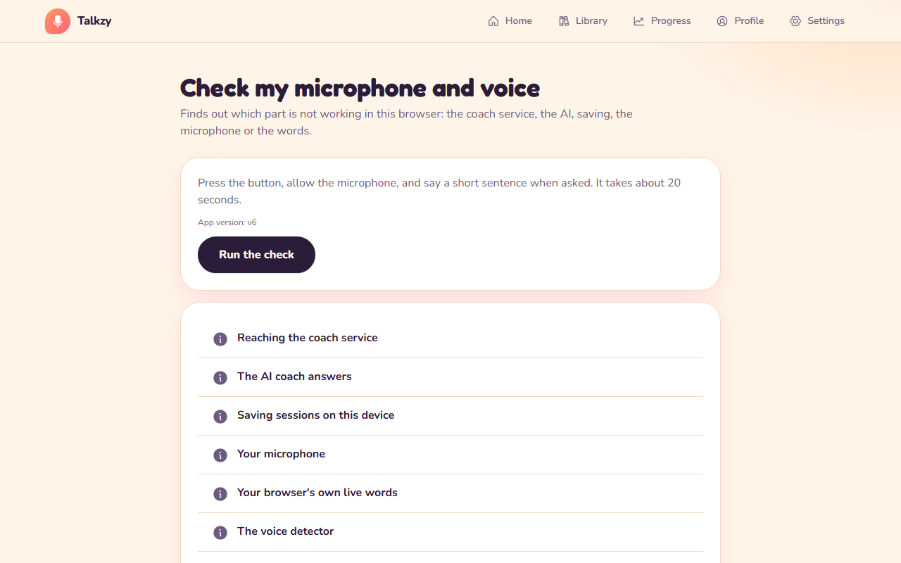<br><sub>The check page.</sub></td>
  </tr>
</table>

## What it measures, and what it never claims

- **Measured:** speaking pace, pauses and thinking time, filler words, repeated words, answer length, word variety, reading accuracy.
- **AI assessment:** grammar, vocabulary, structure and relevance, always labelled as the AI's opinion.
- **Camera (optional, on the device only):** the look of the face, whether the face is in view, head direction, posture and movement. The video never leaves the device. The limits for each look are rough rules (`LOOK_LIMITS` in `src/features/vision/summarize.ts`) and have not been checked on many real faces.
- Pronunciation is **not scored**. Filler words are kept when the speech service writes them, and counts are a lower bound, because recognisers drop some. Word-for-word mode is off by default because it writes English in Hindi letters (`SARVAM_VERBATIM=on` turns it on).
- The camera feedback says how the student **looked**. It never claims to know what they felt, how confident they are, or whether they are honest.

## Tech

- **Next.js 16** (App Router, Turbopack), **React 19**, **TypeScript**, **Tailwind CSS 4**, Zod for validation.
- **Voice in:** [Silero VAD](https://github.com/snakers4/silero-vad) in the browser finds each stretch of speech, and each segment is sent through the app's own server route to **Sarvam** speech-to-text. **Groq Whisper** gives the quick live words. The browser's own recogniser is an automatic fallback.
- **Voice out:** **Cartesia Sonic** through a server route, with your voice ID. It is the only voice.
- **AI:** **Groq** writes the coach's replies (`qwen/qwen3.8-27b` first, then `openai/gpt-oss-20b`, then `openai/gpt-oss-120b` when one is at its per-minute limit) and the report (`openai/gpt-oss-120b`). The free Groq plan allows about 8,000 tokens a minute per model, which is only about 3 coach turns a minute, so a busy app needs a paid Groq plan. A reply that grades the student, claims a past, has no question, or (for the opening) has no greeting is asked for again once. Anthropic is an optional alternative.
- **Camera:** MediaPipe Face and Pose Landmarker, running on the device through WebAssembly.
- **Report files:** jsPDF, in the browser.
- **Tests:** Vitest (5,561 unit tests, including checks of all 360 modules) and Playwright (44 end-to-end tests).
- **AI quality check:** `npm run eval` runs made-up sessions with planted mistakes through the real AI and marks the result. See [How well does the AI feedback work?](docs/EVALUATION.md).

API keys are read only by server code and never sent to the browser. A Content-Security-Policy (`connect-src 'self'`) stops the page contacting any outside server.

## Run it locally

You need **Node.js 20 or newer** and a recent **Chrome or Edge**.

```bash
npm install
npm run dev
```

Open <http://localhost:3000>.

`npm install` also runs `npm run setup:vision`, which copies the MediaPipe runtime and downloads two small pretrained models (about 9 MB) and the Silero voice-detection files (about 17 MB) into `public/`. These files are **not stored in git**; they are downloaded again on every build, including on Vercel. If the download fails the app still works, only without body-language analysis; run `npm run setup:vision` again to retry.

### Add your keys

Everything is optional. Without keys the app runs in a clearly labelled **development mode** (scripted coach, no AI report, browser voice).

```bash
cp .env.example .env.local      # Windows PowerShell: Copy-Item .env.example .env.local
```

| Variable | Used for | Without it |
|---|---|---|
| `GROQ_API_KEY` | The coach's replies, the AI-written report, and the quick live words | Development mode |
| `GROQ_CHAT_MODELS`, `GROQ_REPORT_MODEL` | Optional. The Groq models that talk (best first, comma separated; the next one answers when one is at its limit) and the one that writes the report. Defaults: `qwen/qwen3.8-27b,openai/gpt-oss-20b,openai/gpt-oss-120b` and `openai/gpt-oss-120b`. An old `GROQ_CHAT_MODEL=openai/gpt-oss-20b` is ignored. | The defaults |
| `SARVAM_API_KEY` | Speech-to-text for the student's voice | The browser's own recogniser |
| `CARTESIA_API_KEY` and `CARTESIA_VOICE_ID` | The coach's spoken voice (the only voice) | The browser's own voice |
| `TTS_BACKUP=sarvam` | Optional. Lets Sarvam's voice take over when Cartesia fails (a second voice) | The coach is silent, with the words as text |
| `GROQ_STT_PARTIALS=off`, `GROQ_STT_MODEL` | Optional. Turn off Groq for live words, or change its model | Groq Whisper first, then Sarvam |
| `ANTHROPIC_API_KEY` | Optional alternative to Groq | n/a |

Restart `npm run dev`, then open <http://localhost:3000/api/status>. With everything set it shows `{"mode":"live","llm":"groq","stt":"sarvam","tts":"cartesia"}`. Anything shown as `dev` or `browser` means that key is missing or misspelt. `.env.local` is git-ignored. **Never paste keys into a chat or a file that is uploaded.**

### Scripts

| Command | What it does |
|---|---|
| `npm run dev` | Development server on port 3000 |
| `npm run build` and `npm start` | Production build and server |
| `npm run lint` and `npm run typecheck` | ESLint and TypeScript |
| `npm test` | Unit tests |
| `npm run test:e2e` | End-to-end tests against a production build, using mock voice and AI services. The first run needs `npx playwright install chromium`. |
| `npm run setup:vision` | Re-copy the camera and voice-detection files |

## Deploy to Vercel

1. Upload **the newest upload folder** to GitHub (replacing the old files) and import the repository at [vercel.com/new](https://vercel.com/new). The framework is set to Next.js by `vercel.json`, and the server runs in Mumbai (`bom1`), near the students and the speech services.
2. Add `GROQ_API_KEY`, `SARVAM_API_KEY`, `CARTESIA_API_KEY` and `CARTESIA_VOICE_ID` under **Settings → Environment Variables** (Production and Preview), then deploy. **Redeploy after changing a key**: a new key only works on a new build.
3. If students see a Vercel login page, turn off **Vercel Authentication** under **Settings → Deployment Protection**.
4. When the deployment shows **Ready**, open **Settings** and check that the **app version** is the one you uploaded. Then open `/api/voice/tts?check=1` to see whether the coach's voice works, and `/check` to test everything in the browser.

The rate limiter is in memory and per server instance. Use a shared limiter if you expect heavy traffic.

## Privacy and minors

No accounts and no passwords: a display name only. The student's first name stays on the device (the AI writes it as `{name}` and the app fills it in). Under-13s need a guardian's confirmation. The camera is opt-in each session. Raw audio and video are never stored. Students can turn off transcript saving, and can delete a session or all their data from Settings. Short speech clips go through the app's server to Sarvam and Groq to be turned into text and are then discarded. The app explains this before first use. Schools that deploy it should add their own consent process. See [docs/SECURITY.md](docs/SECURITY.md).

## Project layout

```
docs/                     Product, architecture, design, security, decisions (DECISIONS.md), test plan, screenshots
src/app/                  Pages (home, library, practice, report, progress, profile, settings, check, privacy) and API routes
src/components/           UI, including the reading and conversation screens and the "make room" screen
src/features/content/     8 subjects x 3 levels x 5 goals x 3 age groups = 360 modules (passage, key terms)
src/features/speech/      Speech metrics, reading alignment, voice timing, recognition and synthesis
src/features/vision/      On-device face and pose analysis
src/features/coach/       The coach's prompt, name placeholder, quote checking, model fail-over, scripted dev-mode coach
src/features/report/      The short report, and PDF and text export
src/features/progress/    Daily limit, streaks, trends, recommendations
src/services/             Local storage, the coach's opening, API client, hooks
evals/                    The AI quality check (made-up sessions, marking, results)
tests/unit, tests/e2e     Vitest and Playwright
```

## Known limits

- Pronunciation is not scored, and the camera numbers describe geometry only. Camera accuracy on real people has not been validated.
- Chrome's own speech recogniser and the real voice services are covered by fakes in the tests, not by a real microphone and accent.
- The free Groq plan allows only about 3 coach turns a minute per model; a busy app needs a paid plan. The coach's voice needs Cartesia credit, or it stays silent.
- If a student pauses mid-thought for longer than the waits above, the coach may start answering; if they keep talking she stops and listens.
- Data lives in each browser, with no sync between devices.
